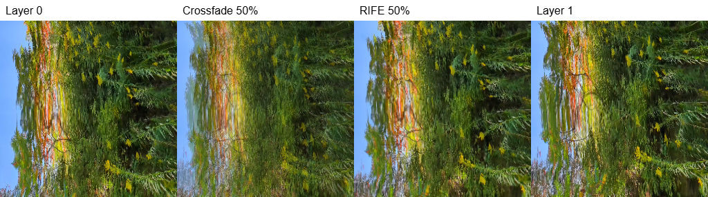
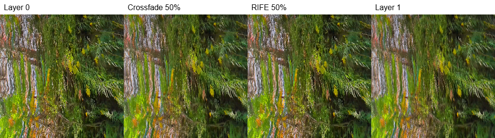

# KTX2 background interpolation during export

Investigated and implemented 2026-10-27.

## Using the implementation

With an animated base background enabled, open **Export Video**, choose
**Ribbon Geometry**, and set **Background interpolation** to
**Motion interpolation (RIFE)**. Crossfade remains the default and the live
preview retains its existing behavior. This option applies to frame-accurate
scene video exports through both the MP4 and WebM encoders. Texture-only exports,
still captures, and legacy realtime recording retain their existing behavior.

`src/modules/viewer/backgroundExportInterpolation.js` owns the streaming export
pipeline. It uses one lazily initialized model session, at most two open tile
containers, two decoded layers per tile, and reusable depth-one array textures.
It skips inference on original-layer endpoints, retains source bytes and ribbon
textures, and releases resources when export succeeds, fails, or is cancelled.
Input/output ONNX tensors are now explicitly disposed after each prediction.
Generated textures preserve source color tagging and regenerate mipmaps when
the source has them, including WebGPU's minification behavior.

The existing timeline supplies exact fractional positions, wrap/ping-pong
ordering, reversal, tile flow, and the single-loop period for repeated exports.
Interpolation runs before background projection, blur, and overlays. Unsupported
alpha/HDR inputs and model failures stop export with an error; they do not
silently substitute crossfade. Cancel is checked between predictions; it cannot
interrupt an individual ONNX inference. RIFE processing retains its existing
1280-pixel limit and enlarges the prediction to the source texture dimensions.

Run unit regressions with `pnpm --filter rivvon test:run` and real browser checks
with `pnpm --filter rivvon test:background-interpolation`. The browser check uses
bundled KTX2 fixtures, actual RIFE inference, WebGL and WebGPU shaders, MP4/x264
and WebM/VP9 encoding, endpoint color comparisons, original-texture restoration,
and cancellation. It requires installed Chrome or Edge (or `BROWSER_BINARY`).
The checks exercise short clips, not a sustained 60-second export.
Set `RIVVON_BACKGROUND_TEST_PROVIDER=wasm` in the test process's environment to
force the real WASM fallback while retaining the same renderers and encoders.

## Finding

The existing RIFE interpolator can generate intermediate images from decoded
KTX2 array layers. A real browser probe succeeded with both the current WebGPU
provider and a forced WASM provider, using bundled `waves` and `planes` textures.
This is now an optional export quality setting. It adds substantial work and
needs visual validation across a full loop before becoming a default.

Preview can retain its inexpensive shader crossfade. Export can substitute a
RIFE-generated source texture at the same animation phase and then use the
existing background effects and video encoders.

## Existing timeline and crossfade path

- `src/modules/viewer/backgroundAnimation.js` computes the adjacent layer pair
  and fractional blend. `waves` traverses all layers and closes last-to-first;
  `planes` traverses forward and backward without duplicating endpoints.
- `resolveBackgroundFrame()` in
  `src/composables/viewer/useSceneBackground.js` selects the background period,
  deterministic export phase, layer pair, and current/next flowing tiles.
- Both the GLSL `sampleLayers()` and WebGPU node equivalent mix two texture-array
  samples at identical UV coordinates. This is a color crossfade, without motion
  estimation. Export defaults to that same temporal blend.
- `src/composables/viewer/useSceneExport.js` renders every output frame at
  `frame / fps`. `renderFrameAtTime()` is synchronous; the enclosing video loop
  is asynchronous and awaits background preparation before rendering each frame
  when motion interpolation is selected, then awaits the encoder.
- Background blur already has separate preview/export profiles. Temporal
  interpolation can follow that separation, but needs a separate option from
  `blurMode` because it also applies when blur is disabled.

The layer count does not impose the background duration. For 240 `waves` layers,
30 source-layer steps per second corresponds to an eight-second cycle. A
60-second background cycle exported at 30 fps has 1,800 output samples across
240 transitions: an average of 7.5 samples per transition. The phase determines
the exact fractional timestep; this is not an integer "insert N frames" setting.
`planes` has `2 * (layerCount - 1)` transitions per complete ping-pong cycle, so
240 layers have a different nominal cycle length.

## Existing reusable pieces

`src/modules/slyce/ktx2TranscodeWorkerClient.js` and
`src/workers/ktx2TranscodeWorker.js` already open KTX2 containers and transcode
individual layers to RGBA32 in a worker. The response contains dimensions and a
transferable pixel buffer, sufficient to construct `ImageData`. Local, cached,
and remote texture loading retain compressed source bytes in `TileManager`'s
`zipFiles`; bundled folder textures can be fetched by tile URL. Copy retained
source bytes before transferring ownership to the decoder.

`src/modules/slyce/rifeInterpolator.js` exposes:

```js
await interpolator.interpolateImageData(layerA, layerB, fractionalTimestep);
```

The bundled RIFE 4.22 model supports explicit timesteps, confirmed in the probe.
Use the exact blend fraction from the background scheduler. Arbitrary-timestep
support is also described by the [RIFE authors](https://github.com/hzwer/ECCV2022-RIFE).

The interpolator is ONNX Runtime, rather than a WASM-only implementation. It
tries WebGPU, WebGL, then WASM on ordinary desktop browsers; Safari follows a
different provider preference. WASM currently uses one thread. Its default
processing limit is 1280 pixels on the longest side, with 64-pixel alignment;
larger inputs are downscaled and the result enlarged again. An export quality
setting should make that resolution policy deliberate.

## Browser probe and evidence

Windows, headless Microsoft Edge 156.0.4314.42, existing RIFE wrapper and bundled
37,370,919-byte ONNX model. Each fixture was tile 0 from
`public/tiles-ktx2-{waves,planes}`, UASTC, 256 x 256, 30 layers. Layers 0, 1, and
29 were decoded; predictions used layers 0 and 1 at timesteps 0.25, 0.5, and
0.75. Layer 29 was decoded to check access, but its wrap interpolation was not
tested. No source-video decoding or KTX2 re-encoding was involved.

| Measurement | WebGPU provider | WASM provider |
| --- | ---: | ---: |
| Model/session initialization | 1.666 s | 1.654 s |
| First 256 x 256 prediction | 1.549 s | 0.316 s |
| Subsequent predictions | 171–189 ms | 249–261 ms |
| Decode three layers, waves | 5.0 ms | 4.6 ms |
| Decode three layers, planes | 1.8 ms | 1.7 ms |

These are short feasibility measurements on one machine, not a sustained export
benchmark. WebGPU initialization reported some operators assigned to CPU. The
WASM run forced provider selection only in a temporary Vite transform; the
application's provider policy was not edited.

At the 240-layer/60-second/30-fps schedule, exact arithmetic gives 120 output
samples on original layers and 1,680 between layers. Using these measured warm
prediction times gives roughly **five minutes of WebGPU inference or seven
minutes of WASM inference per tile**, before scene rendering, uploads, effects,
and encoding. This is an extrapolation; larger textures need separate measures.
Tile flow can require two distinct tile predictions at a given timestamp.

Raw measurements: [background-interpolation/measurements.json](background-interpolation/measurements.json).

Each comparison shows original layer 0, the 50% crossfade, the RIFE 50%
prediction, and original layer 1. RIFE retains sharper structure in the waves
sample; this single midpoint does not establish temporal stability or accuracy.





## Integration design

1. Provide the export-only choice **Crossfade / Motion interpolation (RIFE)**.
   Start with frame-accurate scene video export; the MP4 and WebM paths can share
   preparation before either encoder. Legacy realtime recording remains outside
   this proposal. Still exports can be considered separately.
2. Share a background-frame descriptor between asynchronous preparation and
   synchronous rendering. It must use the existing period, variant, reversal,
   tile-flow mapping, and deterministic timestamps. Preserve the current rule
   that repeated automatic export loops use the original single-loop background
   duration. Do not advance any live phase while preparing an export frame.
3. Maintain one model session and a bounded cache of decoded adjacent layers.
   Interpolate each distinct tile required by that timestamp, skipping inference
   at exact endpoints or for static/disabled base backgrounds. Use a small
   numerical tolerance around exact layer positions. The `waves` closing pair
   must be last-to-first; `planes` must preserve its return traversal and turns.
4. Upload each resulting image into reusable, export-owned background textures.
   A depth-one `DataArrayTexture` is one possible adapter for the existing array
   samplers, with its layer indices set to zero. Keep texture identities stable
   to avoid triggering WebGPU material rebuilds every frame. Do not replace the
   TileManager's shared array textures, which also drive the ribbons.
5. Feed those images into the existing tile sampling and background pipeline,
   before orientation, flow, projection, blur, and crisp overlays. Preserve each
   renderer's existing sRGB/linear-light treatment. Interpolating the final scene
   would also warp foreground geometry, camera motion, and overlays.
6. Await preparation before rendering and encoding each output frame. Release
   model, decoder, temporary textures, and caches on success, failure, and cancel,
   then restore preview sampling. Report model/backend failure explicitly if
   falling back to crossfade. Include interpolation in progress and time estimates.

Do not generate a second enlarged KTX2 asset just to export. Streaming pixels
directly into export textures avoids another lossy encode and storing the whole
expanded sequence. At 512 x 512, 1,800 RGBA8 images alone consume about 1.76 GiB
per tile; at 1024 x 1024 they consume about 7.03 GiB. Model tensors, GPU resources,
blur targets, and encoder memory are additional.

## Quality limits and validation before shipping

KTX2 layers here are spatial cross-sections, not necessarily successive video
frames. `src/modules/slyce/tileBuilder.js` constructs `planes` by sampling
different source rows/columns, and `waves` by changing sampling phase. RIFE can
infer a plausible morph, but does not reconstruct the exact intermediate
cross-section from the original video. Video interpolation during texture
creation and interpolation between finished texture layers are different stages.

Validate a full stretched cycle against crossfade, with low and high blur, for
both variants, reversal, disabled animation, and repeated export loops. Inspect
last-to-first continuity, ping-pong turns, thin features, occlusions, and temporal
flicker. Compare against densely sampled original-source cross-sections where
available; midpoint sharpness alone is insufficient evidence of correctness.

Independently interpolated flowing tiles may develop different boundary pixels.
Check normal and mirrored tile seams; if needed, add neighboring-image context
before inference and crop afterward. Test both renderers for identical
orientation, alpha handling, color interpretation, and restoration after cancel.
The current model consumes RGB and returns opaque alpha, and the decoder rejects
UASTC HDR, so transparent/HDR inputs need a separate policy.

The RIFE wrapper now disposes per-call input/output tensors. Sustained memory
behavior and UI responsiveness during long WASM exports still need device-level
measurement; the wrapper has no per-inference AbortSignal.

Regression coverage includes `backgroundAnimation.test.js`,
`backgroundExportInterpolation.test.js`, `rifeInterpolator.test.js`,
`useSceneBackground.test.js`, and `useSceneExport.video.test.js`. No end-to-end
60-second interpolated export has been benchmarked.
